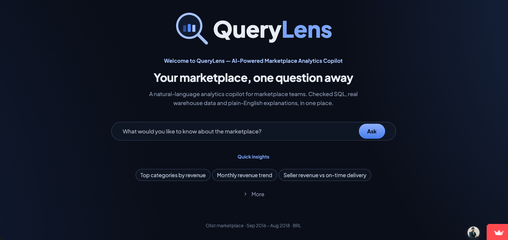
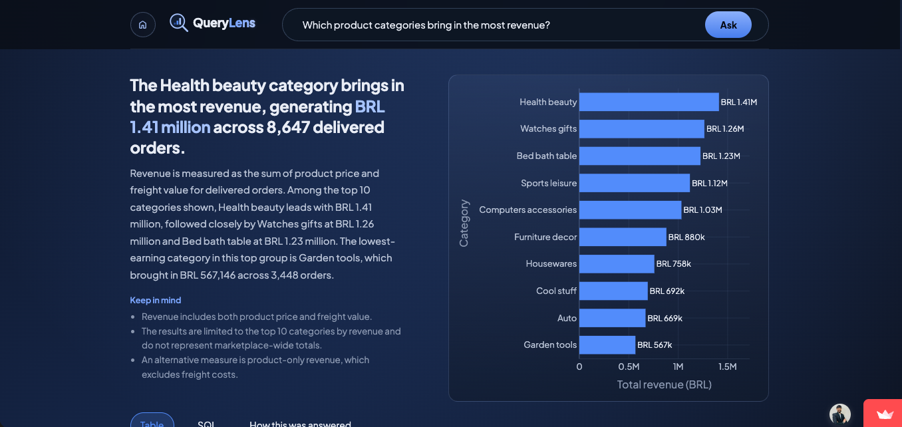
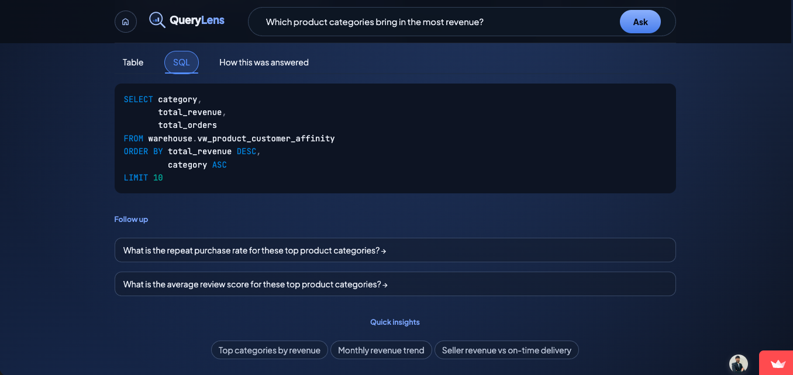
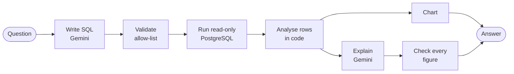

# QueryLens — AI-Powered Marketplace Analytics Copilot

Ask a business question in plain English. QueryLens writes the SQL, checks it, runs it on the warehouse, and explains the result, with a chart and every figure traced back to the data.

### [▶ Try QueryLens](https://querylens-ai-copilot.streamlit.app)


---

## What it does

Business teams have questions such as "Which categories bring in the most revenue?" or "Do late deliveries hurt reviews?", and the answers sit in a warehouse that only SQL can reach. QueryLens closes that gap. A user asks in plain English and gets back:

- **a plain-English explanation** with a headline finding,
- **a chart** chosen to fit the result,
- **the full result table**, from a real query on the warehouse,
- **the SQL that ran**, the measure used and every assumption made,
- **two suggested follow-up questions**, and a one-question memory for asking "and how is delivery there?".

**The language model never answers from memory.** Every answer comes from a real query against validated warehouse views, and every figure in an explanation is checked against the result in code before it is shown. When the data cannot answer a question, QueryLens says so and suggests the closest question it can answer.

### Try it

Each question opens its answer in the app:

| Ask QueryLens | What you'll find |
|---|---|
| [Which product categories bring in the most revenue?](https://querylens-ai-copilot.streamlit.app/?q=Which+product+categories+bring+in+the+most+revenue%3F) | Health & beauty leads with BRL 1.41 million |
| [Do late deliveries get worse reviews than on-time ones?](https://querylens-ai-copilot.streamlit.app/?q=Do+late+deliveries+get+worse+reviews+than+on-time+ones%3F) | Late orders average 2.57 stars against 4.29 for on-time ones |
| [For sellers with at least 50 delivered orders, how does revenue relate to on-time delivery?](https://querylens-ai-copilot.streamlit.app/?q=For+sellers+with+at+least+50+delivered+orders%2C+how+does+revenue+relate+to+on-time+delivery%3F) | No clear relationship: 91.7% on time for the top-earning quarter, 92.3% for the lowest |
| [Which products get returned most often?](https://querylens-ai-copilot.streamlit.app/?q=Which+products+get+returned+most+often%3F) | Returns aren't recorded in the data; QueryLens says so and suggests a related question |

| Landing page | An answer | The SQL behind it |
|---|---|---|
|  |  |  |

---

## How it works



The model is guided by a governed description of the warehouse: every table and view, 33 business metric definitions, and the questions the data cannot answer. It is told to use validated analytical views before raw tables. The SQL must pass an allow-list validator and runs on a read-only connection with a time limit. Facts about the result (highest, lowest, subsets, small samples) are computed in code, and the explanation must rely on them. Prepared answers for common questions load instantly without calling the model.

→ [Architecture](docs/03_architecture.md) · [Metadata layer](docs/02_metadata.md)

---

## How answers are checked

**309 automated tests** (290 offline, 19 against the real model and database), **57 findings** from live testing that each changed how QueryLens behaves, and a **31-question evaluation** graded against figures verified in the warehouse: no wrong answers in the first run, and 31 of 31 correct after fixes.

Two examples of what testing changed:
- A seller with 3 delivered orders ranked first on a "33% on-time rate", so minimum volumes are now measured on each figure's own base.
- An explanation wrote "over BRL 5.7 million" instead of the real figure, so every number is now checked against the result, with one automatic rewrite.

→ [Testing](docs/04_testing.md) · [Evaluation results](docs/05_evaluation_results.md)

---

## Technology

| Layer | Technology |
|---|---|
| Language | Python 3.11 |
| Warehouse | PostgreSQL (Neon when hosted) |
| Language model | Gemini 3.5 Flash (main) and Gemini 3.8 Flash (backup) on Google Cloud Vertex AI, through the Google Gen AI SDK |
| Interface | Streamlit (hosted on Streamlit Community Cloud) |
| Data handling | pandas |
| Charts | Plotly |
| SQL parsing | sqlparse |
| Data description | YAML (PyYAML) |
| Tests | pytest |
| Configuration | python-dotenv locally, Streamlit secrets when hosted |

---

## Repository structure

```text
querylens/
├── app/
│   ├── main.py
│   ├── pipeline.py
│   ├── answers.py
│   ├── session.py
│   ├── llm/
│   │   ├── prompt_builder.py
│   │   ├── sql_generator.py
│   │   └── response_generator.py
│   ├── database/
│   │   ├── connection.py
│   │   └── query_executor.py
│   ├── validation/
│   │   └── sql_validator.py
│   ├── analytics/
│   │   └── analyzer.py
│   ├── visualization/
│   │   ├── charts.py
│   │   └── formatting.py
│   └── ui/
│       ├── brand.py
│       └── styles.py
├── metadata/
│   ├── schema_dictionary.yaml
│   ├── views_reference.yaml
│   ├── business_metrics.yaml
│   └── cached_answers.json
├── scripts/
│   ├── check_setup.py
│   ├── inspect_warehouse_schema.py
│   ├── run_pipeline.py
│   ├── run_evaluation.sh
│   └── build_cached_answers.py
├── sql/
│   └── evaluation_reference_checks.sql
├── docs/
│   ├── 01_product_requirements.md
│   ├── 02_metadata.md
│   ├── 03_architecture.md
│   ├── 04_testing.md
│   ├── 05_evaluation_results.md
│   ├── 06_limitations_and_future_work.md
│   └── screenshots/
│       ├── demo.gif
│       ├── landing.png
│       ├── answer.png
│       └── sql.png
├── tests/
│   ├── test_prompt_builder.py
│   ├── test_sql_generator.py
│   ├── test_live_sql_generator.py
│   ├── test_sql_validator.py
│   ├── test_query_executor.py
│   ├── test_live_database.py
│   ├── test_pipeline.py
│   ├── test_analyzer.py
│   ├── test_charts.py
│   ├── test_formatting.py
│   ├── test_response_generator.py
│   ├── test_live_response_generator.py
│   ├── test_answers.py
│   ├── test_session.py
│   └── test_ui.py
├── .streamlit/
│   └── config.toml
├── .env.example
├── .gitignore
├── requirements.txt
└── README.md
```

---

## Running it locally

**1. Build the warehouse.** QueryLens reads from the PostgreSQL warehouse built by the [Marketplace Analytics Platform](https://github.com/Shaarif-Mohammed/Marketplace-Analytics-Platform). Follow its setup to download the Olist data, create the database, run the schema scripts and load the warehouse, views and model outputs.

**2. Create a read-only role** that can read the `warehouse` schema and nothing else:

```sql
CREATE ROLE querylens_readonly LOGIN PASSWORD 'choose-a-password';
ALTER ROLE querylens_readonly SET default_transaction_read_only = on;
GRANT CONNECT ON DATABASE "Marketplace-Analytics-Platform" TO querylens_readonly;
GRANT USAGE ON SCHEMA warehouse TO querylens_readonly;
GRANT SELECT ON ALL TABLES IN SCHEMA warehouse TO querylens_readonly;
ALTER DEFAULT PRIVILEGES IN SCHEMA warehouse GRANT SELECT ON TABLES TO querylens_readonly;
```

**3. Set up the environment:**

```bash
git clone https://github.com/Shaarif-Mohammed/querylens.git
cd querylens
conda create -n querylens python=3.11 && conda activate querylens
pip install -r requirements.txt
cp .env.example .env
```

**4. Fill in `.env`:**
- the database connection (`DB_*`), using the read-only role;
- the Google Cloud project, location and service-account key for Vertex AI. The service account needs the Vertex AI User role. An AI Studio API key also works for light use: set `GOOGLE_GENAI_USE_VERTEXAI=false` and `GEMINI_API_KEY`.
- for a hosted database such as Neon, `DB_SSLMODE=require`.

When hosting, there is no key file: put the key file's whole JSON in the `GOOGLE_SERVICE_ACCOUNT_JSON` secret instead of `GOOGLE_APPLICATION_CREDENTIALS`, alongside the other settings.

**5. Check the setup and start the app:**

```bash
python scripts/check_setup.py      # confirms read-only access and tests each configured model
streamlit run app/main.py
```

---

## Running the tests

```bash
# Offline: no model, no database, no cost
python -m pytest tests/

# Live database (free): read-only session and query time limit
QUERYLENS_LIVE_DB_TESTS=1 python -m pytest tests/test_live_database.py

# Live model (paid, about USD 0.12 per run)
QUERYLENS_LIVE_LLM_TESTS=1 python -m pytest tests/test_live_sql_generator.py tests/test_live_response_generator.py
```

Rebuilding the prepared answers (`python scripts/build_cached_answers.py`) and re-running the evaluation (`bash scripts/run_evaluation.sh`) both call the model and are paid. See [Testing](docs/04_testing.md) for details.

---

## Limitations

QueryLens answers from a fixed snapshot of marketplace data (September 2016 to August 2018), remembers one question back, and declines questions the data cannot support, such as profit or returns. Explanations are checked figure by figure, and the SQL and full table are always available alongside them.

→ [Limitations and future work](docs/06_limitations_and_future_work.md)

---

## Documentation

1. [Product requirements](docs/01_product_requirements.md): why QueryLens exists and who it is for
2. [Metadata layer](docs/02_metadata.md): the governed description of the data
3. [Architecture](docs/03_architecture.md): how a question becomes an answer
4. [Testing](docs/04_testing.md): what testing found and what guards it now
5. [Evaluation results](docs/05_evaluation_results.md): 31 questions graded against the warehouse
6. [Limitations and future work](docs/06_limitations_and_future_work.md): where QueryLens stops, and where it goes next

---

## What QueryLens can unlock

In most companies the data behind a business question already exists, but reaching it takes SQL, a dashboard that may not cover the question, or a request to an analyst and a wait. QueryLens turns a governed warehouse into answers anyone can get for themselves: operations teams checking where deliveries run late, category managers tracking which categories drive revenue and when, seller managers spotting high earners with poor delivery, CRM teams measuring repeat buying, and leaders reviewing headline performance.

Every answer uses the same metric definitions as the dashboards built on that warehouse and shows the SQL, assumptions and full table behind it. That gives business users self-service without giving up the consistency, safety and traceability that make the numbers worth trusting.

QueryLens runs here on a snapshot of marketplace data, but the approach applies to any organisation whose data sits in a warehouse. Connected to live data, it answers questions about today. With costs, returns, marketing spend or inventory added to its data description, the same checked pipeline answers questions about profitability, returns, acquisition cost and stock-outs. With single sign-on, per-user permissions and an audit trail, each person sees only what they are allowed to see, and every question and answer stays on record. Run on a schedule, it can watch the business and flag when a measure moves. Each new source needs only a description and, where useful, a validated view; the safeguards stay the same.

---

**Data:** [Olist Brazilian E-Commerce Public Dataset](https://www.kaggle.com/datasets/olistbr/brazilian-ecommerce), via the [Marketplace Analytics Platform](https://github.com/Shaarif-Mohammed/Marketplace-Analytics-Platform) warehouse.
