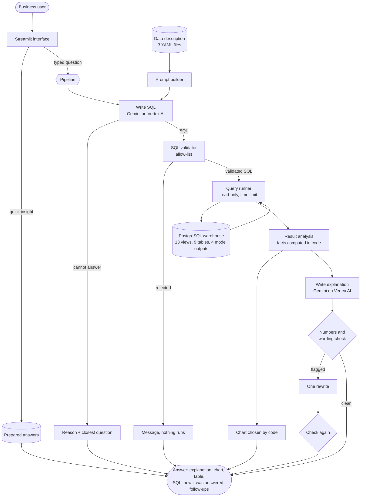
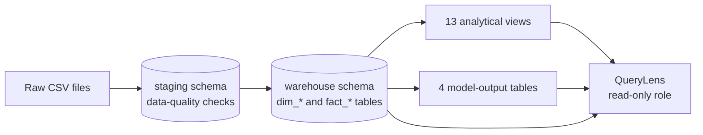

# QueryLens — AI-Powered Marketplace Analytics Copilot
## Architecture

QueryLens turns a plain-English business question into a validated SQL query, runs it against a PostgreSQL warehouse, and explains the result in plain English. One rule shapes the whole design: **the language model never answers from memory.** Every answer comes from a real query on real data, and every figure in an explanation is checked against the result in code. The architecture exists to make that rule hold every time.

This document describes the path a question takes, what each part does, how answers are checked, where QueryLens runs, and the design decisions behind it. The data description the model relies on is covered in [02_metadata.md](02_metadata.md), the testing behind each safeguard in [04_testing.md](04_testing.md), and the remaining limits in [06_limitations_and_future_work.md](06_limitations_and_future_work.md).

---

## 1. Overview



A typed question passes through five steps: **write SQL → validate → run → analyse → explain**. The pipeline stops at the first step that cannot continue and says why in plain English: a question the data cannot answer gets a reason and the closest question it can answer; a query that fails validation never runs. The table and chart appear as soon as the query has run; the explanation follows.

Quick insights take a shorter path. They are complete answers prepared in advance by the same pipeline and served without calling the model or the database, so they load instantly.

---

## 2. One question, end to end

**Question:** "Which states have the most revenue?"

**1. Write SQL.** The model receives the data description and the question, and returns structured output: the SQL, the views it reads, the measure used, its assumptions and two follow-up questions.

```sql
SELECT state, total_revenue, total_orders, revenue_share_pct
FROM warehouse.vw_regional_analysis
ORDER BY total_revenue DESC, state ASC
LIMIT 10
```

- *Measure used:* total revenue (price + freight, delivered orders, BRL) from `vw_regional_analysis`.
- *Assumptions:* region means the customer's state (the seller's state is the main alternative); revenue includes product price and freight.

The model chose the validated regional view rather than joining raw tables, added a tie-breaker to the ordering, and stated how it read the ambiguous word "region".

**2. Validate.** The validator confirms this is one read-only `SELECT`, that `warehouse.vw_regional_analysis` is an approved relation, and that the row limit is within bounds. The query passes unchanged.

**3. Run.** The query runs on a read-only connection with a time limit and returns 10 rows in under a second:

| state | total_revenue | total_orders | revenue_share_pct |
|---|---|---|---|
| SP | 5,769,703.15 | 40,501 | 37.42 |
| RJ | 2,055,401.57 | 12,350 | 13.33 |
| MG | 1,818,891.67 | 11,354 | 11.80 |
| … | … | … | … |
| ES | 317,657.93 | 1,995 | 2.06 |

**4. Analyse.** Code profiles the result: `total_revenue` is the measure, `state` names the rows, and the query took the top 10, so the result is a subset. It writes the facts the explanation may rely on:

> The result has 10 rows.
> The query returned the top 10 rows only, so these rows are a subset; do not describe totals or shares across them as marketplace-wide.
> Highest total_revenue: 5,769,703.15 (SP); lowest: 317,657.93 (ES).

Ten named rows in the query's order become a bar chart.

**5. Explain.** The model receives the question, the measure and assumptions, the facts and the rows — nothing else — and writes:

> **São Paulo (SP) is the leading state by revenue, generating BRL 5.77 million, which represents 37.4% of the marketplace total.**
> Among the 10 states shown, São Paulo leads with BRL 5.77 million from 40,501 orders, followed by Rio de Janeiro with BRL 2.06 million and Minas Gerais with BRL 1.82 million. There is a clear gap between these top three states and the rest, as fourth-place Rio Grande do Sul drops to BRL 861,473…

Code then checks every number: 5.77 million rounds 5,769,703.15, 37.4% rounds 37.42, 861,473 rounds 861,472.79. All are grounded, no overstated wording is found, and the answer is shown with its chart, table, SQL, assumptions and two suggested follow-up questions.

---

## 3. Components

**Interface** — `app/main.py`, `app/session.py`, `app/ui/`, `.streamlit/config.toml`
A Streamlit page with an ask bar, quick-insight shortcuts and an answer view: the explanation beside the chart, with tabs for the table, the SQL and how the answer was produced. While a question runs, the page shows the real step in progress. The question is kept in the page address, so browser back and forward restore earlier answers without a new model call. A link that contains a question waits for the Ask button rather than running on its own.

**Pipeline** — `app/pipeline.py`
Runs the steps in order and returns every intermediate result: the generated SQL, the validation outcome, the rows, the profile and timings for each step. Each outcome has its own status (answered, cannot answer, rejected, failed to run, and so on) and a plain-English message. Empty questions and questions over 1,000 characters are refused before any model call. The explanation is a separate step, so the data is never held back waiting for it and an explanation failure never hides the data. For a follow-up, the pipeline passes the previous question and its SQL — only after an answered question, and only one turn back.

**Data description and prompt builder** — `metadata/*.yaml`, `app/llm/prompt_builder.py`
Three YAML files describe the warehouse: every table and column, all 13 views with their grain and quirks, and 33 business metrics with their definitions, conventions, official sources and the questions the data cannot answer. The prompt builder turns them into the model's instructions, together with the rules: one read-only `SELECT`, warehouse only, views before raw tables, a fixed reference date of 1 September 2018, at most 500 rows, minimum volumes for rankings, defaults for ambiguous words, a refusal path, and a checklist of caveats. Audit-only reference figures in the files are stripped before the instructions are built, so the model can never quote an expected answer. See [02_metadata.md](02_metadata.md).

**Writing SQL and model calls** — `app/llm/sql_generator.py`
Calls the model at temperature 0 with structured output, so every response has the same fields: status, SQL, sources, measure used, assumptions, a reason and closest alternative when the data cannot answer, and follow-up questions. Code cleans the SQL (fences, trailing semicolons) and the follow-ups (at most two, distinct, no overstated wording). Every model call in QueryLens goes through one shared routine that handles failures: a busy model is retried with waits, a stalled one hands over to the backup model, a retired one is skipped, and a bad request stops at once.

**SQL validator** — `app/validation/sql_validator.py`
An allow-list, not a deny-list. A query passes only if it is a single `SELECT` (or `WITH … SELECT`) reading approved warehouse relations, which are taken from the same data description the model sees. It rejects write and schema statements anywhere, multiple statements, other schemas and system catalogues, unknown or unqualified relations, risky functions and anything it cannot parse with confidence. It keeps a top-level limit of up to 500 rows, adds one if missing, and caps larger ones. Comments are stripped, and the SQL that runs is exactly the SQL that was validated.

**Query runner** — `app/database/connection.py`, `app/database/query_executor.py`
Accepts only a passed validation and validates it again. Each query gets its own read-only database session and a statement time limit (20 seconds by default), fetches at most 500 rows (flagging when more existed), and always rolls back and closes. Errors are returned as messages, never raised to the interface. Results arrive as a pandas DataFrame with numbers and dates in their proper types.

**Result analysis** — `app/analytics/analyzer.py`
Works out what the result is before anyone describes it: which column is the measure, which names the rows, whether the rows are a ranking, a time series, a two-way table or a pair of measures, and whether the result is complete or a top-N subset. It writes plain-English facts from the rows — row count, date range, highest and lowest values with their names, shares of a total, totals across a grid, and how many rows rest on small samples. It also blanks growth figures that compare with an almost empty period.

**Explanation** — `app/llm/response_generator.py`
The model receives only the question, the measure and assumptions, the facts and the rows (up to 50, or a whole two-way table as a grid) and returns a headline, an explanation and caveats. Code checks every number against the input, allowing only honest rounding, and checks for overstated wording. Anything flagged triggers one rewrite that names each problem and the nearest real figure. Anything still flagged after that is shown with a short note to rely on the table. Rules the model broke repeatedly are enforced here in code.

**Charts and formatting** — `app/visualization/charts.py`, `app/visualization/formatting.py`
The chart type follows from the result's shape, chosen by code: a line for periods, several lines for a few measures over time, bars for rankings and groups, a heatmap for two-way tables, a scatter for two measures across many rows, and a single figure card for one row. Charts always plot the measure the explanation describes. Formatting turns column names into readable titles with units, shortens long IDs, prints compact figures and lays out the SQL for reading.

**Quick insights and session limits** — `app/answers.py`, `metadata/cached_answers.json`, `scripts/build_cached_answers.py`
Ten representative questions and one follow-up are answered in advance by the real pipeline and stored as complete answers. They are displayed exactly like live answers and never touch the model or the database. The build script saves an answer only if its numbers check passed, and every rebuilt answer is checked by hand before it is kept. Typed questions are capped at 18 per session; quick insights do not count.

---

## 4. How answers are checked

Trust comes from several independent layers, so no single one has to be perfect:

1. **Instructions:** the model is told what the data contains, how each metric is defined, which source is official, and what it must decline.
2. **Validator:** only a single read-only query on approved warehouse relations can pass.
3. **Read-only database:** the database role cannot write and cannot see anything outside the warehouse; each session is also read-only on its own.
4. **Time limit:** a valid but expensive query is stopped by the database.
5. **Facts in code:** what is highest, lowest, complete or a small sample is computed from the rows, not judged by the model.
6. **Numbers and wording check:** every figure in an explanation must trace to the result, with one automatic rewrite.
7. **Everything visible:** the SQL, the measure used, the assumptions and the full table are always available beside the explanation.

What each layer was built in response to, and the tests that guard it, are in [04_testing.md](04_testing.md).

---

## 5. The data layer

QueryLens sits on an existing marketplace analytics warehouse built from the public Olist Brazilian e-commerce dataset (about 100,000 orders, September 2016 to August 2018).



- **Star schema:** order line items at item grain; payments and reviews at order grain, joined on the order.
- **13 analytical views** hold the business logic already validated for dashboards: customer health, RFM segments, lifetime value, retention cohorts, seller performance, delivery experience, regional and category analysis, payment behaviour, and monthly revenue split by new and returning customers.
- **4 model-output tables** hold seller clusters, category clusters and seller outlier flags, saved when the models were run.
- **Read-only role:** QueryLens connects as a role that can read the warehouse schema only. It cannot write anything and cannot see the staging schema.

**Views first.** The model is instructed to answer from a view whenever one covers the question and to fall back to raw tables only when none does. Views carry business logic that has already been checked; raw joins are where double-counting and fan-out errors happen. In evaluation, the official view was used for every question a view could answer.

---

## 6. Deployment and configuration

| Part | Service | Notes |
|---|---|---|
| Application | Streamlit Community Cloud | Deployed from the GitHub repository; public link |
| Database | Neon (serverless PostgreSQL) | Warehouse schema only, restored from the local warehouse; AWS US West (Oregon), close to Streamlit Community Cloud's servers; pooled, encrypted connections; read-only role |
| Language model | Gemini through Google Cloud Vertex AI | Main model `gemini-3.5-flash`, backup `gemini-3.8-flash`, global location; service account with the Vertex AI User role |

**Secrets** — the database credentials and the service-account key — are kept in Streamlit's secrets manager when hosted and in a local `.env` file during development, never in the repository. Hosted, there is no key file, so the key's JSON is held in the `GOOGLE_SERVICE_ACCOUNT_JSON` secret; locally, `GOOGLE_APPLICATION_CREDENTIALS` points to the key file kept outside the project. `.env.example` lists the settings a working setup needs, with placeholders; the rest (timeouts, the SQL thinking budget) have defaults in code.

**Configurable settings** include the models and backup models, the request timeout, the thinking budgets for SQL and explanations, the database connection and statement time limit, and the per-session question cap. Changing the model needs no code change.

**Safeguards for public use:**
- 18 typed questions per session, with no visible counter until the limit is reached.
- A monthly spending cap on model calls in Google Cloud, with a budget alert before it.
- Quick insights that work even when the cap is reached, the model is slow, or the database is waking up.
- A question in a shared link never triggers a model call on its own.

---

## 7. Cost, speed and size

**Instructions.** The data description and rules come to about 27,500 tokens. A full SQL request, including the question, is about 28,400 input tokens and about 200 output tokens. The model also spends about 900 to 4,250 tokens reasoning before it writes the SQL.

**Cost per question.** Most of the instructions are identical on every call, so Vertex AI serves about 24,000 tokens from its cache at a lower rate. With caching, the SQL step costs about **USD 0.008** (about USD 0.024 without), and a whole answered question, including the explanation, about **USD 0.01**.

**Speed.**

| Step | Typical time |
|---|---|
| Write SQL | 4–18 s |
| Validate | under 0.1 s |
| Run query | 0.1–1 s |
| Write and check explanation | 2–3 s (more when a rewrite is needed) |
| **Whole question** | **about 10–20 s**; up to about 40 s when the model is busy |
| Quick insight | instant |

The explanation uses a small reasoning budget (256 tokens). That cut its time from 5–10 seconds to 2–3 seconds with no loss of quality; the numbers check catches the slightly looser rounding it brings. The SQL step keeps the model's full reasoning, because that is where judgment matters most.

---

## 8. Design decisions

**Views before raw tables.**
*Chosen:* answer from validated views whenever one covers the question. *Instead of:* letting the model join raw tables freely. *Why:* views carry business logic that has already been checked, so the model chooses and filters rather than re-deriving metrics, and two people asking the same question get the same answer.

**Facts computed in code, not by the model.**
*Chosen:* the analyzer computes what is highest, lowest, complete or a small sample, and the explanation must rely on it. *Instead of:* asking the model to read the table and judge. *Why:* the SQL step writes its caveats before any data exists; facts from the rows let the explanation keep the caveats the data supports and drop the ones it contradicts.

**One automatic rewrite, then show the answer.**
*Chosen:* a flagged explanation is rewritten once, with the problems named; anything still flagged is shown with a note. *Instead of:* retrying until clean, or hiding the answer. *Why:* it caps cost and waiting time, and the data is always correct and visible regardless of the wording.

**Rules the model breaks twice move into code.**
*Chosen:* instructions remain for the first attempt, and repeated failures are enforced in code. *Instead of:* adding ever more instructions. *Why:* code is a guarantee; an instruction is a request.

**Charts chosen by code.**
*Chosen:* the chart type follows from the result's shape. *Instead of:* letting the model pick or style charts. *Why:* the same shape always gets the same chart, and the chart always plots the measure the explanation describes.

**Memory of one question back.**
*Chosen:* a follow-up sees only the previous question and its SQL. *Instead of:* a long conversation history. *Why:* every answer stays traceable to what it was built on, and long histories tend to drift.

**No retrieval system or agent framework.**
*Chosen:* one structured model call to write SQL, one to explain, with the data description sent in full. *Instead of:* a vector search over documentation, or a model that plans and calls tools in a loop. *Why:* the description fits comfortably in one request, caching makes it inexpensive, and a fixed pipeline is easier to test, audit and explain. Every step can be inspected on its own.
